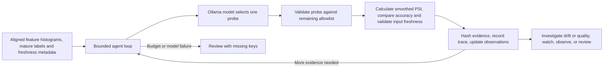

# Architecture

The local language model selects one evidence probe per turn. The loop validates the returned action, executes the corresponding read-only function and sends the resulting observation back to the model. A deterministic domain policy consumes the validated evidence to produce the decision and source IDs. Missing required evidence yields review. The JSON report includes the trace and per-probe SHA-256 digests.

## Execution boundaries

The caller provides the JSON snapshot. The model selects an action from the probes that have not run yet. The default budget is four calls. Invalid and duplicate actions consume budget. Model timeouts and invalid responses stop the loop and retain evidence collected so far. Only the local Ollama endpoint receives the observations.

Bins must be aligned upstream. PSI uses a 0.25 threshold with additive smoothing. The demonstration uses aggregate, synthetic signals and does not automatically retrain or roll back a model.
